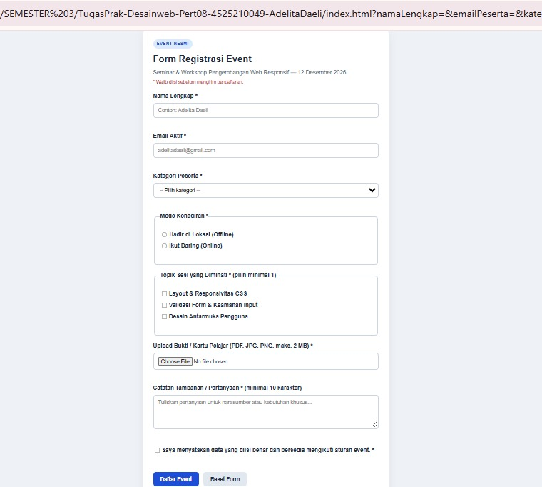
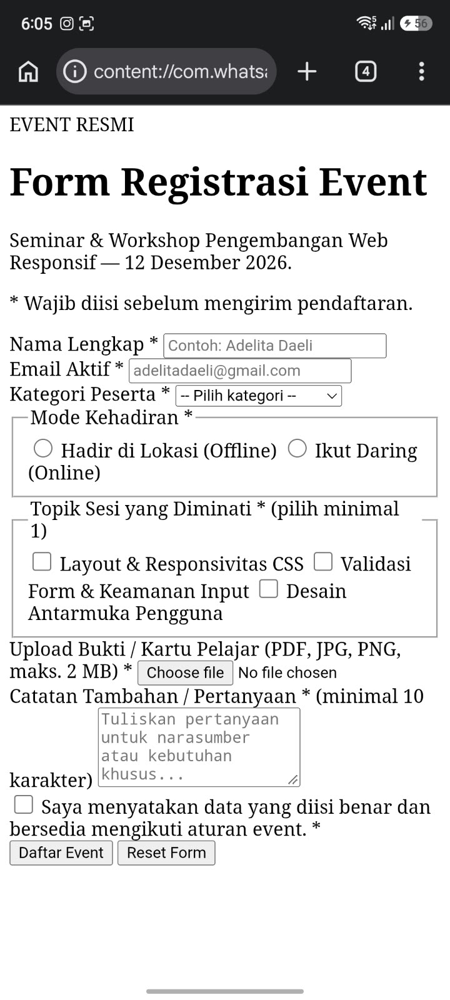

# Form Registrasi Event — Validasi Form Web

Proyek ini merupakan *form* registrasi *event* berbasis HTML5, CSS3, dan JavaScript yang dirancang responsif untuk tampilan *desktop* maupun *mobile*. Formulir ini mencakup komponen input teks, email, `select`, `radio`, `checkbox`, `upload` berkas (`input type="file"`), serta `textarea` yang dilengkapi dengan enam aturan validasi pada sisi klien.

## Ringkasan Pengembangan, Masalah, dan Solusi

Proyek ini membangun *form* registrasi *event* menggunakan HTML5, CSS3, dan JavaScript yang memuat elemen *text*, *email*, *select*, *radio*, *checkbox*, *upload* file, dan *textarea* beserta enam aturan validasi pada sisi klien untuk memastikan kelengkapan data pendaftar sebelum formulir dikirimkan.

Selama proses pengembangan, ditemukan beberapa kendala teknis yang memengaruhi kenyamanan serta kejelasan umpan balik bagi pengguna. Pertama, validasi bawaan *browser* saja menghasilkan tampilan peringatan yang berbeda-beda antarperamban sehingga pesan kesalahan terasa kurang konsisten dan sulit dikontrol penempatannya. Kedua, elemen pilihan seperti *radio* dan *checkbox* tidak memiliki satu kotak input tunggal layaknya input teks, sehingga indikator kesalahan perlu ditempatkan secara terpisah agar pengguna langsung mengetahui bagian mana yang belum diisi. Ketiga, pada bagian unggahan berkas, pengguna berpotensi memilih format file yang tidak didukung atau ukuran file yang terlalu besar. Keempat, pada layar sempit (*mobile*), susunan tombol aksi berpotensi terlihat sempit jika tetap disejajarkan secara horizontal.

Untuk mengatasi permasalahan tersebut, ditambahkan fungsi validasi JavaScript terpusat yang menampilkan pesan kesalahan khusus pada setiap *field* serta memberi penanda visual berwarna merah pada input yang tidak valid. Selain itu, diterapkan pengecekan tipe berkas (PDF, JPG, PNG) dan batas ukuran maksimal 2 MB, serta pengaturan *media query* CSS agar tata letak kartu dan tombol tetap rapi di layar *desktop* maupun *mobile*.

## Struktur Folder

```text
registrasi-event/
├── index.html
├── css/
│   └── style.css
├── js/
│   └── script.js
├── Dokumentasi/
│   ├── desktop.png
│   └── mobile.png
└── README.md
```

## Test Case Validasi (5 Skenario Input Salah)
Test Case 1 — Validasi Panjang Nama Lengkap

Field: namaLengkap (Input Teks)

Input Uji: "Ad" (hanya 2 karakter)

Hasil yang Diharapkan: Pengiriman formulir ditolak dan muncul pesan kesalahan "Nama lengkap wajib diisi minimal 3 karakter." di bawah kolom nama.

Hasil Aktual: Pengiriman ditolak, pesan kesalahan muncul pada #err-namaLengkap, dan kotak input berubah berwarna merah muda (invalid-input).

2. Test Case 2 — Validasi Format Alamat Email

Field: emailPeserta (Input Email)

Input Uji: "adelita-tanpa-domain" (tidak mengandung simbol @ dan domain valid)

Hasil yang Diharapkan: Pengiriman formulir ditolak dan muncul pesan kesalahan "Masukkan alamat email yang valid (contoh: nama@email.com)." di bawah kolom email.

Hasil Aktual: Pengiriman ditolak, pesan kesalahan muncul pada #err-emailPeserta, dan kotak input email ditandai merah.

3. Test Case 3 — Validasi Pilihan Checkbox Topik Sesi

Field: topik (Checkbox)

Input Uji: Tidak ada satu pun kotak pilihan topik sesi yang dicentang saat tombol kirim ditekan.

Hasil yang Diharapkan: Pengiriman formulir ditolak dan muncul pesan kesalahan "Pilih minimal satu topik sesi yang diminati." di bawah kelompok checkbox.

Hasil Aktual: Pengiriman ditolak dan pesan kesalahan tampil jelas pada #err-topik di bawah daftar pilihan topik.

4. Test Case 4 — Validasi Tipe & Ukuran Berkas Unggahan

Field: buktiFile (Input File / Upload)

Input Uji: Mengunggah berkas berformat .exe atau berkas gambar berukuran 3.5 MB (melebihi batas 2 MB).

Hasil yang Diharapkan: Pengiriman formulir ditolak dan muncul pesan kesalahan bahwa format berkas harus PDF, JPG, atau PNG dengan ukuran maksimal 2 MB.

Hasil Aktual: Pengiriman ditolak, pesan kesalahan sesuai pelanggaran muncul pada #err-buktiFile, dan kolom unggah berkas ditandai merah.

5. Test Case 5 — Validasi Panjang Minimal Catatan Tambahan

Field: catatan (Textarea)

Input Uji: "Halo" (hanya 4 karakter, kurang dari batas minimal 10 karakter)

Hasil yang Diharapkan: Pengiriman formulir ditolak dan muncul pesan kesalahan "Catatan minimal 10 karakter." di bawah kotak catatan.

Hasil Aktual: Pengiriman ditolak, pesan kesalahan tampil pada #err-catatan, dan area teks catatan ditandai merah.


## Validasi yang Tetap Wajib Dilakukan di Server

1. **Verifikasi tipe MIME, ekstensi, dan isi file unggahan:** Server tetap wajib memeriksa tipe file sebenarnya agar berkas berbahaya tidak lolos ke penyimpanan server meskipun validasi *browser* dilewati.
2. **Batas ukuran file & sanitasi teks:** Server harus membatasi ukuran unggahan serta membersihkan karakter pada input teks dan `textarea` untuk mencegah injeksi data.
3. **Kewajiban field, format email, dan daftar opsi valid (`select` & `radio`):** Server wajib memastikan nilai yang dikirim sesuai daftar opsi yang sah karena permintaan bisa dikirim langsung di luar formulir HTML.
4. **Aturan bisnis & kuota peserta:** Pengecekan ketersediaan kuota kehadiran *offline*/*online* maupun duplikasi pendaftaran hanya dapat dipastikan secara akurat di sisi server dan *database*.

## Dokumentasi Hasil Website

### Tampilan Desktop


### Tampilan Mobile


## Catatan Tugas

* **Jenis Tugas:** Tugas Individu (dikerjakan secara mandiri).
* **Bukti Kelengkapan:** *Source code* project, *screenshot* tampilan *desktop* dan *mobile*, tabel *test case* validasi, pembahasan validasi server, serta ringkasan pengembangan.
